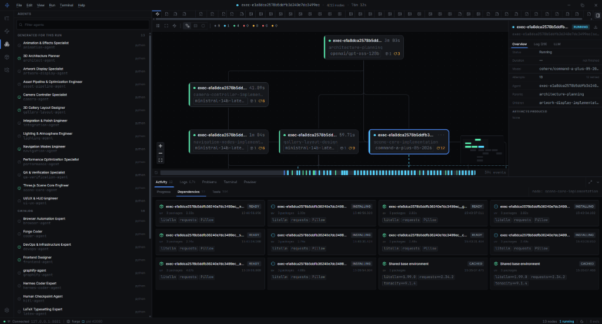
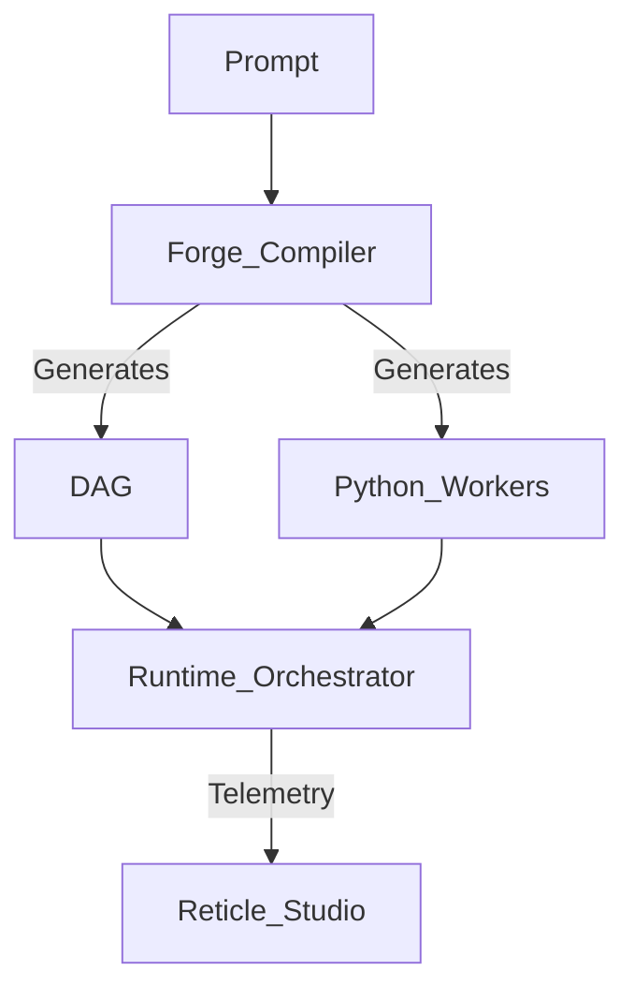
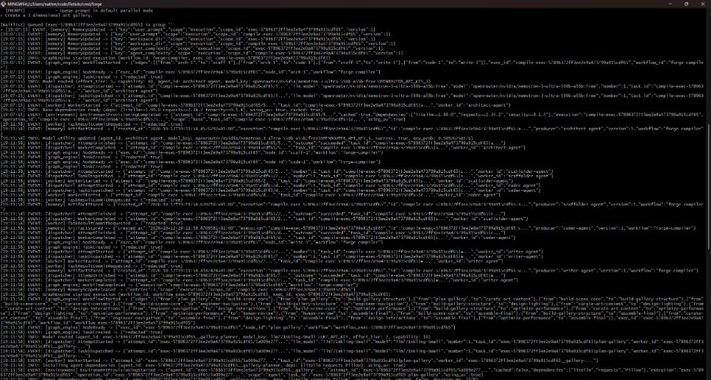
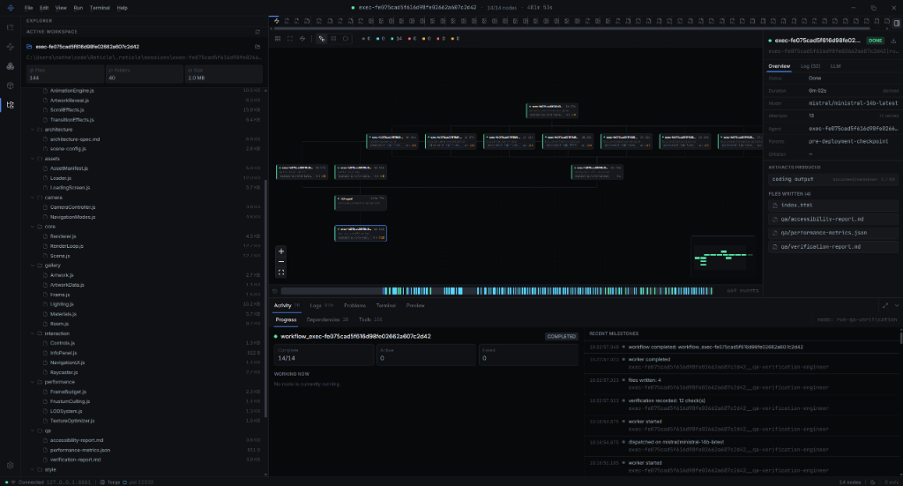
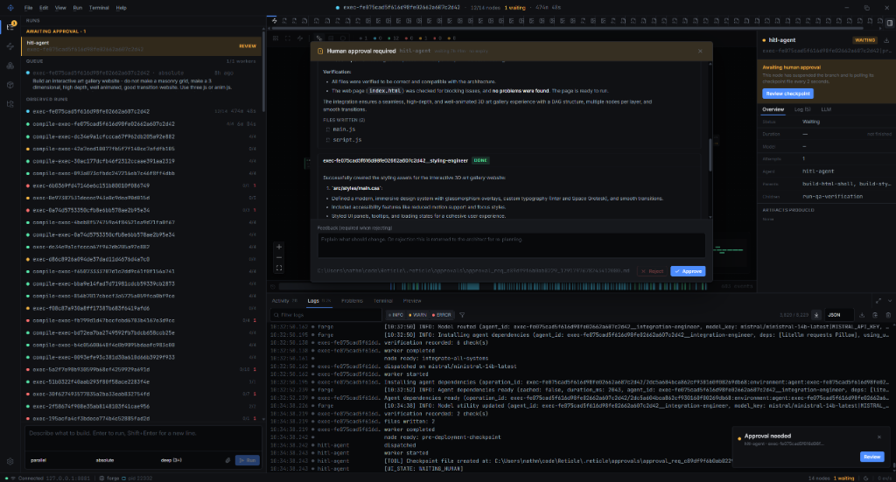
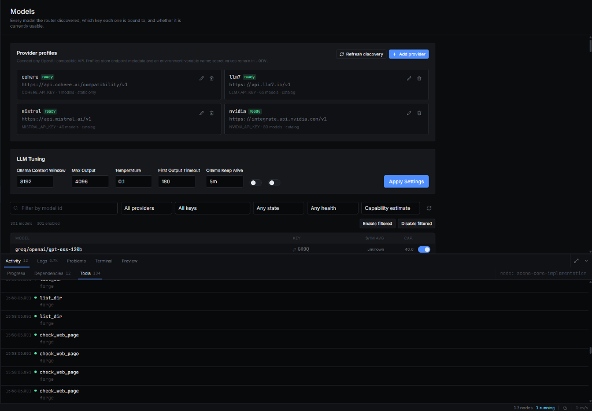

<div align="center">
  <!-- Place your logo here -->
  <!--  -->

  # Reticle Orchestrator

  **A local-first, polyglot agent orchestration framework.**

  [](https://go.dev/)
  [](https://python.org)
  License terms pending (the repository LICENSE file is currently empty).
  []()
</div>

---

> Reticle's Go runtime executes bounded directed acyclic graphs (DAGs), while its built-in **Forge** compiler dynamically generates execution-scoped workflows and bespoke Python workers directly from a natural language prompt.

<div align="center">
  
</div>

---

## Core Features

- **Autonomous Compilation Pipeline (`forge`)**:
  - Simply pass a prompt like `"Build a 2D Platformer"`.
  - The runtime dynamically provisions an **Architect** to design a DAG, a **Scaffolder** to generate physical project structure, and a **Coder** to synthesize bespoke, specialized Python agents on the fly.
- **Polyglot Execution**: A blazing-fast Go-based orchestrator that communicates seamlessly with isolated Python workers via versioned JSON over STDIO.
- **Shared Worker Tools**: Compiled workers leverage a common SDK providing contained file operations, bounded execution, and explicit verification. The compiler writer aggregates file maps; it is not automatically injected into task workflows.
- **Intelligent Routing & Retry**: The router selects enabled models based on capability, capacity, cooldown, and observed outcome scores. Forge implements a resilient retry policy for transient failures that are safe to retry.
- **Targeted Workspace Context**: Workers receive bounded IDE context, declared shared-memory facts, upstream artifacts, and contained workspace tools, inspecting additional files as needed instead of injecting the entire source tree into every prompt.
- **Telemetry and Studio**: Monitor executions in real-time. The control server exposes authenticated events, while Reticle Studio projects workflow snapshots, logs, files, dependency activity, approvals, and physical artifacts in a sleek desktop UI.

## Architecture

Reticle consists of two primary systems working in tandem:

### 1. The Runtime Engine
Located in `runtime/`, the Go orchestrator manages the lifecycle, event bus, and execution of DAGs.
- **GraphEngine**: Parses `workflow.yaml` files and manages cross-layer dependencies.
- **Memory System**: Handles multi-scope (Global, Workflow, Execution) variable injection.
- **Workers**: Isolated processes (e.g., Python scripts) that subscribe to the event bus and process node executions.

### 2. The Forge Compiler
Located in `cmd/forge/`, the compiler acts as a meta-workflow. It transforms a natural language objective into a fully functional workspace containing a custom DAG and dynamically generated Python agents.

<div align="center">
  <!-- Architecture diagram placeholder -->
  <!--  -->
  


</div>

## Getting Started

### Prerequisites
- [Go](https://go.dev/) (latest recommended)
- [Python 3.10+](https://python.org)
- [Docker](https://www.docker.com/) (Default command environment)

### 1. Build the compiler
```bash
cd cmd/forge
go build -o forge.exe
```

### 2. Setup your API Keys
Create a `.env` file in the root directory:
```env
GROQ_API_KEY=your_groq_key
OPENROUTER_API_KEY=your_or_key
```

### 3. Run a Prompt
Launch the orchestrator with an inline prompt or interactively via the Forge execution shell:
```bash
.\forge.exe -port 8080 "Create a 3 dimensional art gallery"
```

<div align="center">
  
  <p><em>Forge CLI dynamically compiling the architecture DAG, scaffolding the workspace, and dispatching isolated execution workers.</em></p>
</div>

### 4. Iterative Development
Use follow-on edits to tweak generated workspaces:
```bash
.\forge.exe -workspace ./workspaces/forge_workspace_XXX "Make the blocks fall 50% slower"
```

## Telemetry GUI (Reticle Studio)

When running `forge`, the telemetry server boots automatically. Navigate to `http://localhost:<PORT>` (default `8080`) to monitor execution in a high-tech visualizer. Waitlist queues, task durations, physical output artifacts, and verification checkpoints are instantly mapped and interactive.

### Autonomous Workspace Synthesis

Monitor complete end-to-end DAG execution as Forge compiles natural language requirements into physical files, automated QA audits, and isolated virtual environments.

<div align="center">
  
  <p><em>Full workflow completion (14/14 nodes) with generated workspace tree (144 files across 40 folders) and QA verification reports.</em></p>
</div>

### Human-in-the-Loop Governance & Checkpoints

Reticle provides first-class human verification gates before deployment. Nodes can suspend execution branches to solicit feedback or approval, automatically returning to the architect for re-planning on rejection.

<div align="center">
  
</div>

### Provider Profiles & LLM Tuning

Reticle Studio also provides a dedicated control plane for OpenAI-compatible provider registration, local Ollama tuning, timeout configurations, and live tool telemetry.

<div align="center">
  
</div>

## Resources & Documentation

- [Current Documentation](docs/README.md)
- [Environment Configuration](docs/environment.md)
- [Audit Repair Status](docs/audit/2026-09-08/03-repair-status.md)

---

*Note: The control server binds loopback and requires an access code; Studio reads it automatically. Docker is the default command environment. Choose native execution explicitly for trusted host commands.*
